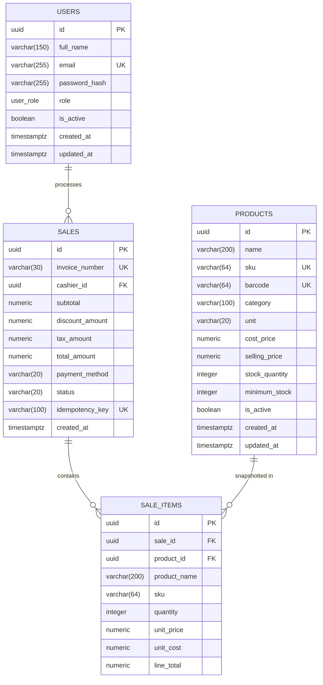

# Database design — ORVIA

Four tables only: `users`, `products`, `sales`, `sale_items`, plus the
`user_role` enum type and the `invoice_number_seq` sequence. 41 columns total.

> In the diagram below, every `numeric` attribute is `NUMERIC(12,2)`.

## Rules encoded in the database

- Money: `NUMERIC(12,2)` everywhere, with non-negative CHECK constraints.
- `sales.total_amount = subtotal - discount_amount + tax_amount` (CHECK).
- `sales.discount_amount <= subtotal` (CHECK).
- `sale_items.line_total = quantity * unit_price` (CHECK) and `quantity > 0`.
- `sales.status IN ('COMPLETED','CANCELLED')`,
  `sales.payment_method IN ('CASH','CARD')`.
- `products.barcode` is nullable and unique; empty input is normalised to NULL.
- FKs use `ON DELETE RESTRICT`: history is never deleted, only soft-disabled.
- Every sale carries a unique `idempotency_key`.
- Invoice numbers come from `CREATE SEQUENCE invoice_number_seq START 1`
  formatted as `INV-{YYYY}-{seq:06d}`. The sequence is not reset yearly, so
  gaps are acceptable.

## Indexes

| Index | Purpose |
| --- | --- |
| `ix_products_name` | product search / ordering |
| `ix_sales_created_at` | sales history + reports by date |
| `ix_sales_cashier_id` | cashier-scoped sales list |
| `ix_sale_items_sale_id` | invoice details |
| `ix_sale_items_product_id` | top products / profit aggregation |

Unique constraints already index `users.email`, `products.sku`,
`products.barcode`, `sales.invoice_number`, `sales.idempotency_key`.

## Timestamps

All timestamps are `TIMESTAMPTZ` stored in UTC. Daily report grouping uses
`REPORT_TIMEZONE` (default `UTC`).

The full reference DDL lives in `backend/alembic/versions/0001_initial_schema.py`.
